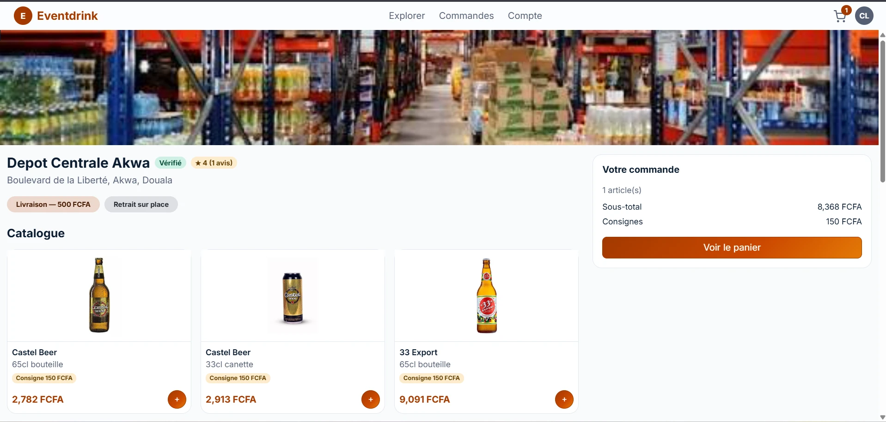

# 🍺 Eventdrink

**La plateforme qui livre les boissons de vos événements.**

Eventdrink met en relation les **clients** (mariages, anniversaires, cérémonies…) et les **dépôts de boissons** : on trouve le dépôt le plus proche, on estime ses quantités, on commande en livraison ou en retrait, et le dépôt gère ses stocks, ses ventes et ses consignes au même endroit.

Projet réalisé dans le cadre de l'**Angular Talent Lab 2026** (sprint de 5 jours).

| | |
|---|---|
| 🌐 **Application** | https://event-drink-iota.vercel.app |
| 🔌 **API** | https://event-drink-3b4e.vercel.app |
| 📄 **Contrat d'API** | [API_CONTRACT.md](API_CONTRACT.md) |



---

## 📑 Sommaire

1. [Fonctionnalités](#-fonctionnalités)
2. [Stack technique](#-stack-technique)
3. [Architecture du projet](#-architecture-du-projet)
4. [Installation en local](#-installation-en-local)
5. [Comptes de test](#-comptes-de-test)
6. [Sécurité](#-sécurité)
7. [Déploiement](#-déploiement)
8. [Organisation du travail](#-organisation-du-travail)
9. [Limites connues et perspectives](#-limites-connues-et-perspectives)

---

## ✨ Fonctionnalités

L'application propose trois espaces selon le rôle de l'utilisateur.

### 👤 Espace Client

- **Compte** : inscription, connexion, mot de passe oublié par email, modification du profil.
- **Explorateur de dépôts** : carte OpenStreetMap, géolocalisation, rayon de recherche, filtre « livraison disponible », distance et note moyenne.
- **Fiche dépôt** : catalogue avec photos, prix et consignes, avis des autres clients.
- **Calculateur intelligent** : estime les quantités de boissons selon le type d'événement et le nombre d'invités, sur le catalogue réel du dépôt, puis remplit le panier.
- **Commande** : panier, choix livraison ou retrait, adresse et instructions, suivi du statut en temps réel, historique.
- **Consignes** : suivi des casiers et bouteilles consignés et du montant bloqué.
- **Avis** : notation de 1 à 5 étoiles après livraison.

### 🏪 Espace Dépôt

- **Inscription puis onboarding** du dépôt, avec validation par l'administrateur.
- **Tableau de bord** : commandes du jour, en attente, volume par période.
- **Catalogue et stocks** : prix, consigne, disponibilité, quantité en stock, seuil d'alerte, mouvements entrée/sortie avec historique.
- **Commandes reçues** : traitement par étapes (confirmée → en préparation → en route → livrée, ou prête à retirer → terminée).
- **Statistiques de vente** : chiffre d'affaires, panier moyen, croissance, courbe d'évolution, répartition par catégorie, top produits.
- **Abonnement** : paliers Standard (5 000 FCFA) et Premium (10 000 FCFA), paiement Mobile Money, historique.
- **Consignes, paramètres et compte** du dépôt.

### 🛡️ Espace Administrateur

- **Tableau de bord** global : dépôts actifs, en attente, chiffre d'affaires, plaintes.
- **Validation ou blocage des dépôts**.
- **Catalogue central** des produits (création et modification).
- **Registre des plaintes** : consultation, résolution, actions.

### 📱 Transversal

- **Mobile-first** : interface pensée pour le téléphone (barre d'onglets en bas, cartes empilées à la place des tableaux), vérifiée aussi sur ordinateur.
- Navigation instantanée (préchargement des routes) et interface avec effets verre et dégradés aux couleurs de la marque.

---

## 🧰 Stack technique

| Couche | Technologies |
|---|---|
| **Front-end** | Angular 21 (composants standalone, signals, routes lazy-loaded), Bootstrap 5.3, Bootstrap Icons, Leaflet + OpenStreetMap, Chart.js |
| **Back-end** | NestJS 11 (API REST), class-validator, guards JWT et rôles |
| **Base de données** | PostgreSQL ([Neon](https://neon.tech), serverless) avec Prisma 6 et migrations versionnées |
| **Authentification** | JWT (Passport), mots de passe hachés (bcrypt) |
| **Emails** | Nodemailer (SMTP Gmail) pour la réinitialisation du mot de passe |
| **Hébergement** | Vercel (front et back-end en fonction serverless) |
| **Outils** | Git / GitHub (une branche par fonctionnalité, Pull Requests) |

---

## 🗂️ Architecture du projet

Le dépôt contient le front-end à la racine et le back-end dans `backend/`.

```
event-drink/
├── src/                      # Front-end Angular
│   └── app/
│       ├── core/             # Modèles, services HTTP, guards, intercepteur JWT
│       ├── shared/           # Composants et mises en page partagés
│       └── features/
│           ├── auth/         # Connexion, inscription, mot de passe oublié
│           ├── client/       # Espace client
│           ├── depot/        # Espace dépôt
│           └── admin/        # Espace administrateur
├── backend/                  # API NestJS
│   ├── prisma/               # Schéma, migrations, données de démo (seed)
│   ├── api/                  # Point d'entrée de la fonction serverless Vercel
│   └── src/
│       ├── auth/ users/      # Authentification, comptes
│       ├── depots/           # Dépôts, catalogue par dépôt, stocks, statistiques
│       ├── catalogue/        # Catalogue central des produits
│       ├── commandes/        # Commandes, consignes, statuts
│       ├── avis/ plaintes/   # Avis clients, plaintes
│       ├── abonnement/       # Abonnements et paiements
│       ├── admin/            # Statistiques globales, validation des dépôts
│       └── mail/             # Envoi d'emails
├── docs/captures/            # Captures d'écran pour la documentation
├── API_CONTRACT.md           # Contrat d'API entre le front et le back
└── vercel.json               # Configuration de déploiement du front
```

---

## 🚀 Installation en local

### Prérequis

- Node.js 22 ou plus et npm
- Une base PostgreSQL (le projet utilise Neon : créer un projet gratuit sur [neon.tech](https://neon.tech))

### 1. Cloner et installer

```bash
git clone https://github.com/Aly-leo/event-drink.git
cd event-drink
npm install
cd backend
npm install
```

### 2. Configurer le back-end

Créer `backend/.env` à partir du modèle :

```bash
cp .env.example .env
```

Puis renseigner les **vraies** valeurs :

| Variable | Rôle |
|---|---|
| `DATABASE_URL` | Connexion Neon (pooler) |
| `DIRECT_URL` | Connexion Neon directe, utilisée par les migrations |
| `JWT_SECRET`, `JWT_EXPIRES_IN` | Signature et durée des jetons |
| `FRONT_URL` | URL du front (CORS), `http://localhost:4200` en local |
| `SMTP_HOST`, `SMTP_PORT`, `SMTP_USER`, `SMTP_PASS`, `SMTP_FROM` | Envoi d'emails (optionnel en local) |

> Le fichier `.env` ne doit **jamais** être commité.

### 3. Préparer la base de données

```bash
npx prisma generate
npx prisma migrate deploy
npx prisma db seed
```

> Si la base est partagée avec l'équipe et déjà alimentée, ne pas relancer `db seed` : les comptes de test existent déjà.

### 4. Lancer l'application

Dans un premier terminal, le back-end sur `http://localhost:3000` :

```bash
cd backend
npm run start:dev
```

Dans un second terminal, le front-end sur `http://localhost:4200` :

```bash
npm start
```

### Commandes utiles

| Commande | Effet |
|---|---|
| `npm run build` | Compile le front pour la production |
| `npx prisma studio` (dans `backend/`) | Explorer la base de données dans le navigateur |
| `npx prisma migrate dev --name <nom>` (dans `backend/`) | Créer une migration après modification du schéma |

---

## 🔑 Comptes de test

Mot de passe commun : `Password123!`

| Rôle | Email |
|---|---|
| Administrateur | `admin@eventdrink.test` |
| Client | `client@eventdrink.test` |
| Dépôt (validé) | `depot1@eventdrink.test` |
| Dépôt (validé) | `depot2@eventdrink.test` |
| Dépôt (en attente de validation) | `depot3@eventdrink.test` |

---

## 🔒 Sécurité

- **Rôles appliqués côté serveur** : chaque route est protégée par un guard JWT et un guard de rôle, pas seulement masquée dans l'interface.
- **Cloisonnement des données** : un dépôt n'accède jamais aux données d'un autre dépôt. Les ressources « du dépôt connecté » sont résolues à partir du jeton, jamais d'un identifiant envoyé par le navigateur. Une ressource non autorisée répond `404` plutôt que `403`.
- **Montants calculés par le serveur** : prix, consignes, frais de livraison, total des commandes et prix des abonnements sont recalculés côté serveur.
- **Mots de passe** : hachés avec bcrypt. La réinitialisation utilise un lien à usage unique qui expire au bout d'une heure, dont seul le hash est stocké. La réponse est identique que l'email existe ou non, pour empêcher l'énumération des comptes.
- **CORS** restreint au front déployé et à ses déploiements de prévisualisation.

---

## ☁️ Déploiement

Le front et le back-end sont déployés sur **Vercel**, dans deux projets distincts pointant sur le même dépôt GitHub.

| Projet | Dossier racine | Configuration |
|---|---|---|
| **Front-end** | `/` | [`vercel.json`](vercel.json) : build Angular et réécriture des routes vers `index.html` |
| **Back-end** | `backend/` | [`backend/vercel.json`](backend/vercel.json) : migrations Prisma, build NestJS, fonction serverless `backend/api/index.js` |

- Chaque push sur `main` redéploie les deux projets.
- L'URL de l'API utilisée par le front est définie dans `src/environments/environment.ts`.
- Les variables d'environnement du back-end (voir ci-dessus) se configurent dans les réglages du projet Vercel du back-end.

---

## 👥 Organisation du travail

- **Alyssa Nkolo** (cheffe d'équipe) : architecture, API NestJS, schéma Prisma, authentification, espace administrateur, espace client, intégration et déploiement.
- **Nadia** : espace dépôt (interface, abonnement, statistiques, gestion de stock).
- **Carmen** : espace client.

Méthode de travail :

- Une **branche par fonctionnalité**, jamais de commit direct sur `main`.
- **Pull Request** vers `main`, relue avant fusion.
- Le **contrat d'API** ([API_CONTRACT.md](API_CONTRACT.md)) est mis à jour à chaque nouvelle route pour que le front et le back avancent en parallèle.

---

## 🧭 Limites connues et perspectives

**Limites actuelles**

- Le **paiement d'abonnement est simulé** : pas de connexion à une vraie passerelle Orange Money ou MTN MoMo.
- Les **photos et documents** se renseignent par lien, sans téléversement de fichier.
- Les **plaintes** peuvent être traitées par l'administrateur, mais il n'existe pas encore d'écran client pour en déposer.
- La **restitution des consignes** n'est pas encore confirmable par le dépôt.

**Prochaines étapes**

- Intégration d'un vrai paiement Mobile Money.
- Téléversement d'images et de documents.
- Notifications en temps réel (WebSocket) et par SMS ou WhatsApp.
- Sélection de la position du dépôt sur une carte à l'inscription.
- Application installable (PWA).

---

## 📄 Licence

Projet pédagogique réalisé dans le cadre de l'Angular Talent Lab 2026.
